# ADRIA Bank — plateforme bancaire distribuée

Rapport technique de l'épreuve **ADRIA / ENSET PFE 2027** (architecture micro-services, IA et full-stack).
Auteur : Badreddine Toubani.

La plateforme gère des comptes bancaires et des transactions. Elle publie des événements métier dans Kafka et
propose un assistant conversationnel qui agit sur les comptes au moyen de tools MCP. Elle comprend un front
Angular sécurisé par Keycloak et un volet de détection de fraude.

Toutes les sorties et captures de ce rapport viennent d'une exécution réelle de la stack, le 30/10/2026.

---

## Sommaire

1. [État d'avancement](#1-état-davancement)
2. [Architecture](#2-architecture)
3. [Conception : diagramme de classes](#3-conception--diagramme-de-classes)
4. [Micro-services métier (partie C)](#4-micro-services-métier-partie-c)
5. [Micro-services techniques (partie D)](#5-micro-services-techniques-partie-d)
6. [Sécurité Keycloak](#6-sécurité-keycloak)
7. [Chatbot agentique (partie E)](#7-chatbot-agentique-partie-e)
8. [Kafka (partie F)](#8-communication-asynchrone-avec-kafka-partie-f)
9. [Front Angular (partie G)](#9-front-angular-partie-g)
10. [Détection de fraude (partie H)](#10-détection-de-fraude-partie-h)
11. [DevOps (partie I)](#11-devops-partie-i)
12. [Tests](#12-tests)
13. [Lancer le projet](#13-lancer-le-projet)
14. [Limites connues et améliorations](#14-limites-connues-et-améliorations)

---

## 1. État d'avancement

| Partie | Sujet | État |
|---|---|---|
| A | Projet Maven multi-modules, commits réguliers | ✅ pom agrégateur, 7 modules, 25 commits |
| B | Diagramme de classes et architecture | ✅ sections 2 et 3 |
| C.1 | account-service : REST + GraphQL + MCP | ✅ |
| C.2 | transaction-service : règles métier, virement, REST + GraphQL + MCP | ✅ |
| C.3 | OpenFeign + Resilience4J | ✅ circuit breaker + fallback |
| D.1 | Spring Cloud Gateway | ✅ routes `lb://` via Eureka |
| D.2 | Eureka | ✅ |
| D.3 | Config-service (`bank.transaction.max-amount=1000`) | ✅ |
| — | Sécurité Keycloak (OAuth2 / OIDC / JWT) | ✅ services métier et front (voir limites en §14) |
| E | Agent IA (Spring AI + MCP), client REST | ✅ client REST et web ; pas de client Telegram ni Discord |
| F | Kafka : producer + consumer d'audit | ✅ |
| G | Client Angular | ✅ |
| H | Détection de fraude | ⚠️ pipeline scikit-learn écrit mais non exécuté ; détection par LLM fonctionnelle |
| I | DevOps | ⚠️ Compose pour l'infrastructure seulement ; pas de Dockerfiles ni de CI ; réponses en §11 |

---

## 2. Architecture

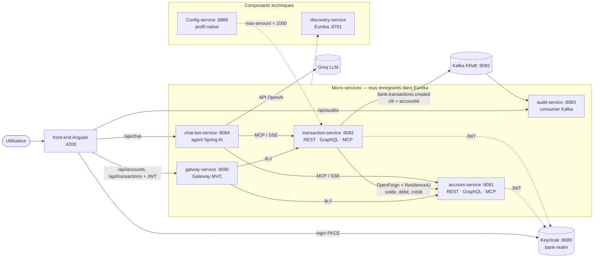

### Services et ports

| Module | Port | Rôle | Stack principale |
|---|---|---|---|
| `Config-service` | 8888 | Configuration centralisée (fichiers `classpath:/config`) | Spring Cloud Config Server |
| `discovery-service` | 8761 | Annuaire des services | Netflix Eureka Server |
| `gatway-service` | 9090 | Point d'entrée unique des API | Spring Cloud Gateway Server MVC |
| `account-service` | 8081 | Comptes bancaires | Web MVC, JPA/H2, GraphQL, serveur MCP |
| `transaction-service` | 8082 | Transactions, virements | idem + OpenFeign, Resilience4J, Kafka producer |
| `audit-service` | 8083 | Journal des événements | Kafka consumer, JPA/H2 |
| `chat-bot-service` | 8084 | Agent IA + scoring de fraude | Spring AI 2.0 (OpenAI-compatible), client MCP |
| `front-end` | 4200 | Interface web | Angular 22, keycloak-js |
| Keycloak | 8080 | Identité, JWT | Keycloak 26.2 (Docker) |
| Kafka | 9092 | Bus d'événements | apache/kafka 3.9.1, mode KRaft (Docker) |

Socle commun : Java 21, Spring Boot 4.0.9 / 4.1.2, Spring Cloud 2025.1.4 et Spring AI 2.0.1.

Les ports 8888 et 9999 étaient déjà occupés sur la machine de développement. La gateway écoute donc sur 9090.

### Séparation des couches

Chaque service métier suit le découpage imposé par l'énoncé :

```
toubani/badr/<service>/
  domain/        entités JPA + enums
  repository/    Spring Data JPA
  service/       interface + implémentation : toutes les règles métier
  web/rest/      @RestController            ─┐
  web/graphql/   @Controller (@QueryMapping)  ├─> appellent la même méthode de service/
  mcp/           @Tool (Spring AI)          ─┘
  dto/  exception/  config/  client/ (Feign)  event/ (Kafka)
```

Les trois connecteurs (REST, GraphQL, MCP) ne contiennent **aucune** logique métier. Par exemple, `createPayment`
est la même méthode de `TransactionService`, qu'on l'appelle par `POST /api/transactions`, par la mutation GraphQL
`createTransaction` ou par le tool MCP `createPayment`.

---

## 3. Conception : diagramme de classes

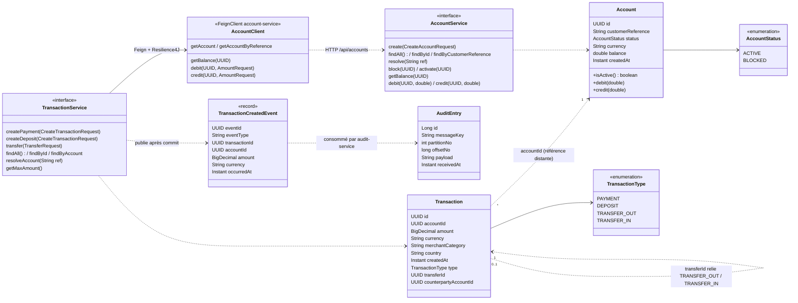

`Account` et `Transaction` vivent dans deux bases différentes, une par service. Le lien `accountId` n'est pas une
clé étrangère : la cohérence passe par les appels Feign au moment de chaque transaction.

---

## 4. Micro-services métier (partie C)

### 4.1 account-service

| Opération | REST | GraphQL | Tool MCP |
|---|---|---|---|
| Lister | `GET /api/accounts` | `accounts` | `listAccounts` |
| Consulter | `GET /api/accounts/{id}` · `GET /by-reference/{ref}` | `accountById` · `accountByReference` | `getAccount(account)` |
| Créer | `POST /api/accounts` (201) | `createAccount(input)` | `createAccount` |
| Bloquer / activer | `PUT /{id}/block` · `PUT /{id}/activate` | `blockAccount` · `activateAccount` | `blockAccount` · `activateAccount` |
| Solde | `GET /{id}/balance` | — | `getBalance(account)` |
| Débit / crédit | `POST /{id}/debit` · `POST /{id}/credit` | — | — (réservé à transaction-service) |

Règles appliquées dans `AccountServiceImpl` :

- la référence client est unique (409 sinon) ;
- la devise est un code ISO 4217 en 3 lettres majuscules ;
- le solde initial est positif ou nul ;
- un compte est créé `ACTIVE` ;
- débit et crédit exigent un compte actif et un montant strictement positif ;
- un débit exige un solde suffisant.

Les tools MCP acceptent un UUID **ou** une référence client (`CUST-001`). Un LLM manipule ainsi des identifiants
lisibles par un humain.

Au démarrage, `DataInitializer` crée 4 comptes de démonstration : CUST-001 (EUR 5000), CUST-002 (EUR 1200),
CUST-003 (MAD 20000) et CUST-004 (EUR 300, **BLOCKED**).

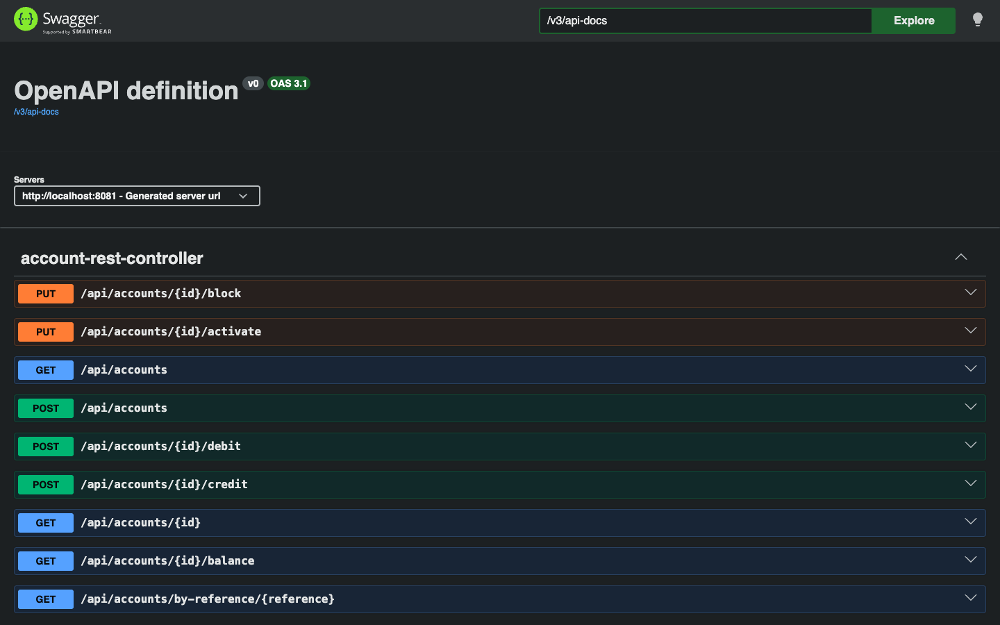

### 4.2 transaction-service

`createPayment` applique les règles de l'énoncé dans cet ordre. Le plafond est lu au démarrage depuis le
config-service.

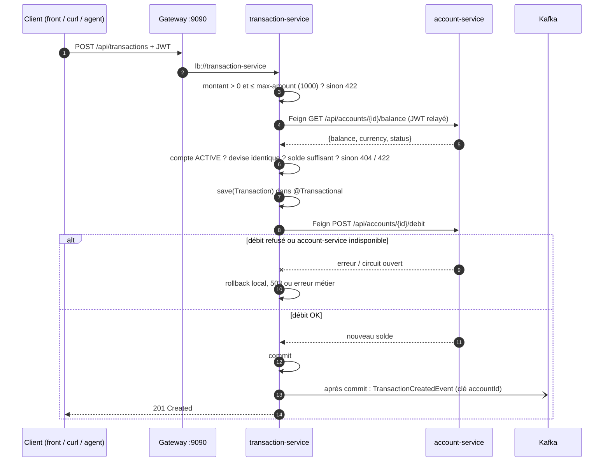

| Règle (énoncé) | Exception | HTTP | Test unitaire |
|---|---|---|---|
| montant strictement positif | `InvalidAmountException` / validation `@Positive` | 422 / 400 | `amountMustBeStrictlyPositive` |
| montant ≤ plafond configuré | `AmountLimitExceededException` | 422 | `amountAboveLimitIsRefused` |
| le compte existe | `AccountNotFoundException` | 404 | `unknownAccountIsRefused` |
| le compte est actif | `AccountBlockedException` | 422 | `blockedAccountIsRefused` |
| devise de la transaction = devise du compte | `CurrencyMismatchException` | 422 | `currencyMismatchIsRefused` |
| consultation du solde avant chaque transaction | `InsufficientBalanceException` | 422 | `insufficientBalanceIsRefused` |
| solde mis à jour après enregistrement | débit / crédit Feign | — | `paymentDebitsAccount`, `depositCreditsAccountWithoutBalanceCheck` |
| account-service en panne | `AccountServiceUnavailableException` | 503 | `transferIsCompensatedWhenCreditFails` |

Exécution réelle via la gateway, avec un JWT Keycloak :

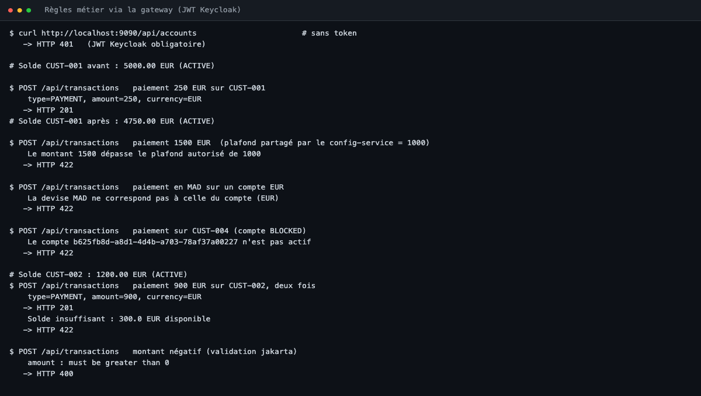

#### Virement

`transfer` contrôle d'abord que les deux comptes sont différents, existent, sont actifs et sont dans la devise
demandée, que le montant respecte le plafond et que la source a un solde suffisant. Il crée ensuite **deux
transactions** liées par un `transferId` (`TRANSFER_OUT` sur la source, `TRANSFER_IN` sur la cible), débite la
source puis crédite la cible.

Si le crédit échoue, une **compensation** re-crédite la source, et la transaction locale est annulée par rollback.

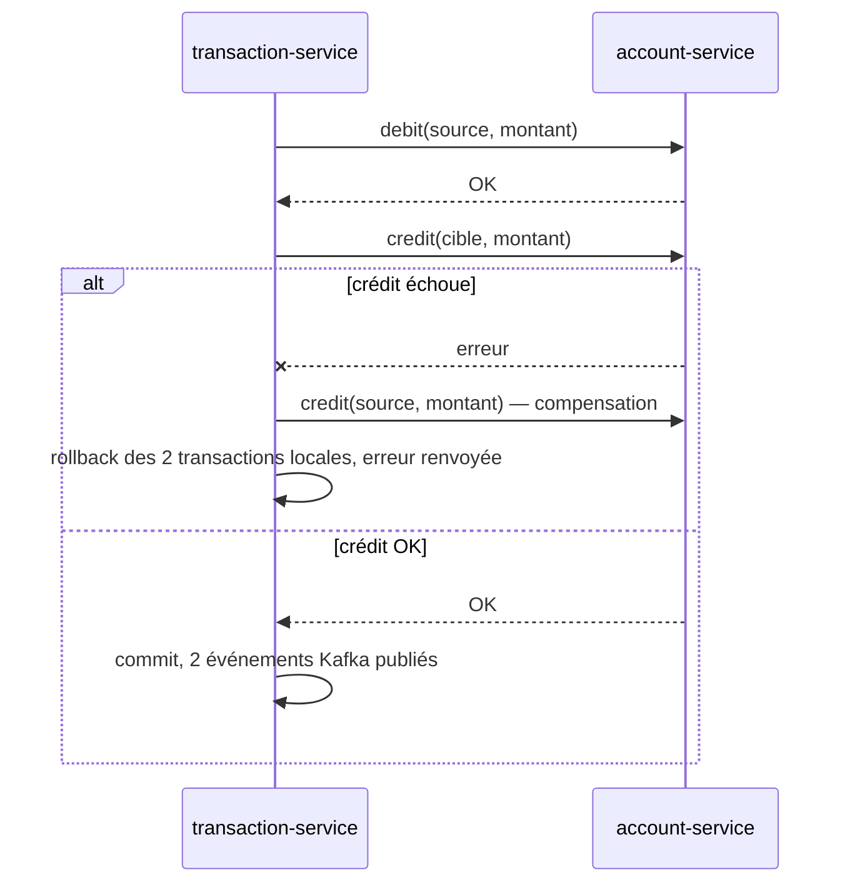

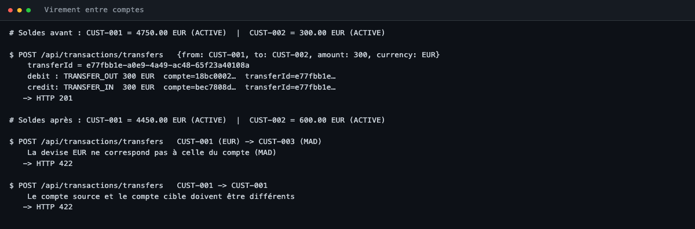

#### GraphQL

Les deux schémas sont dans `src/main/resources/graphql/*.graphqls`. GraphiQL est activé. Via la gateway, le
préfixe `/account-service` ou `/transaction-service` est retiré par `StripPrefix=1`.

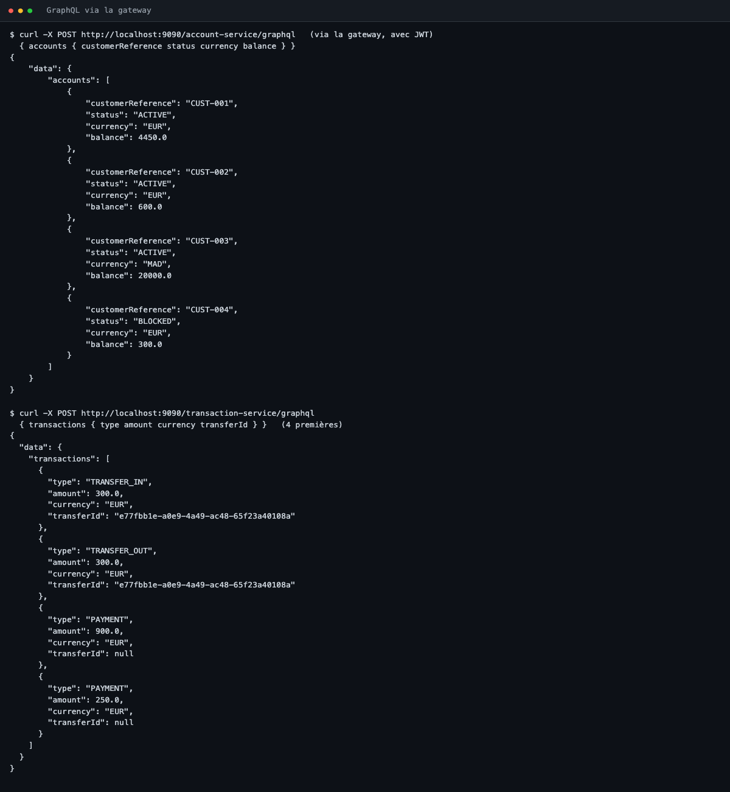

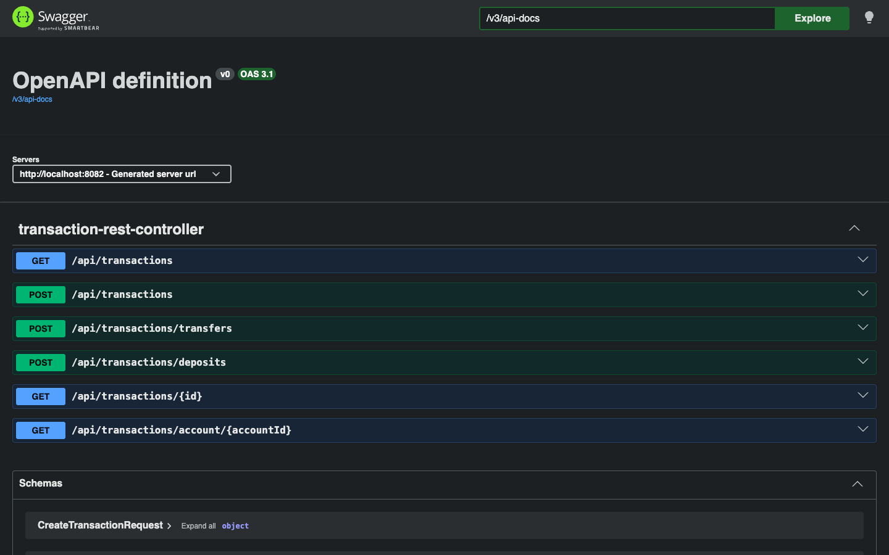

### 4.3 Communication inter-services : OpenFeign + Resilience4J (C.3)

- **`AccountClient`** (`@FeignClient(name = "account-service")`) : aucune URL en dur, l'adresse est résolue par
  Eureka et le load-balancer Spring Cloud.
- **`FeignAuthConfig`** relaie l'en-tête `Authorization: Bearer …` de la requête entrante. account-service reçoit
  donc le JWT de l'utilisateur.
- **Circuit breaker** (`spring.cloud.openfeign.circuitbreaker.enabled=true`) :

  | Paramètre | Valeur |
  |---|---|
  | Fenêtre glissante | 10 appels |
  | Nombre minimum d'appels | 5 |
  | Seuil d'échec | 50 % |
  | Durée en état ouvert | 10 s |
  | Appels autorisés en semi-ouvert | 2 |
  | Timeout | 3 s |

  Les erreurs fonctionnelles 400, 404, 409 et 422 sont **ignorées** : un compte introuvable n'est pas une panne et
  ne doit pas ouvrir le circuit.
- **`AccountClientFallbackFactory`** : une erreur 4xx est propagée telle quelle. Une panne technique (timeout,
  service arrêté, circuit ouvert) devient `AccountServiceUnavailableException` (HTTP 503). Aucun solde n'est
  inventé : l'opération est refusée.

---

## 5. Micro-services techniques (partie D)

### D.1 Gateway

`gatway-service` utilise Spring Cloud Gateway **Server MVC**. Ses routes sont déclarées dans `application.yaml` :

| Route | Prédicat | Destination |
|---|---|---|
| `account-api` | `Path=/api/accounts/**` | `lb://account-service` |
| `transaction-api` | `Path=/api/transactions/**` | `lb://transaction-service` |
| `account-service` | `Path=/account-service/**` + `StripPrefix=1` | `lb://account-service` (GraphQL, MCP, Swagger) |
| `transaction-service` | `Path=/transaction-service/**` + `StripPrefix=1` | `lb://transaction-service` |

La gateway ne valide pas le JWT : elle le transmet, et ce sont les services qui le vérifient.

### D.2 Eureka

Le discovery-service (`@EnableEurekaServer`) ne s'enregistre pas lui-même (`register-with-eureka: false`). Les
6 autres services s'y enregistrent avec leur adresse IP (`prefer-ip-address: true`).

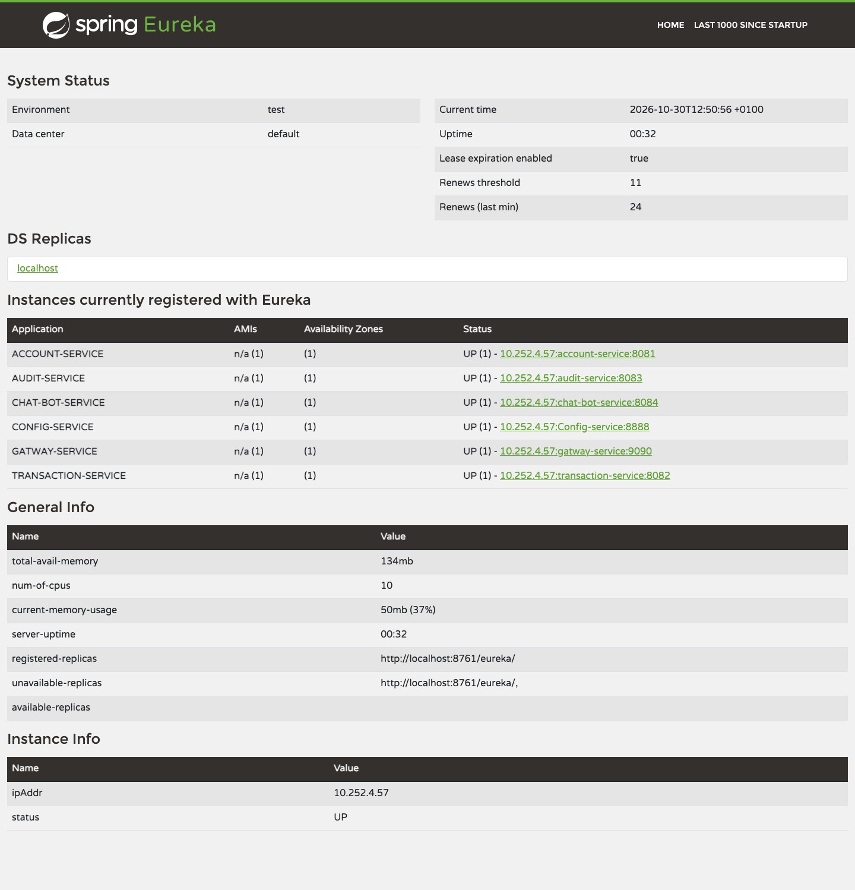

### D.3 Config-service

Le Config Server tourne en profil `native` : il lit les fichiers de `Config-service/src/main/resources/config/`.
Le paramètre partagé de l'énoncé est dans `config/application.yaml` :

```yaml
bank:
  transaction:
    max-amount: 1000
```

Les clients (account, transaction, gateway) l'importent avec
`spring.config.import: optional:configserver:http://localhost:8888`. transaction-service n'a **pas** de valeur
locale : il ne peut fonctionner qu'avec la valeur reçue du config-service. La règle du plafond (422 au-delà de
1000) le montre en §4.2.

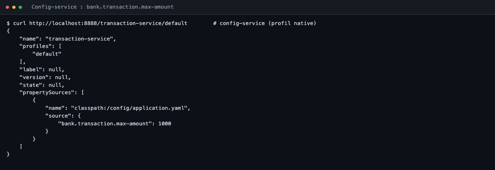

---

## 6. Sécurité Keycloak

Le realm `bank-realm` est importé au démarrage du conteneur depuis `keycloak/bank-realm-realm.json`.

| Élément | Valeur |
|---|---|
| Rôles du realm | `USER`, `ADMIN`, `AGENT` |
| Client `bank-front` | public, PKCE, redirection `http://localhost:4200/*` |
| Client `bank-agent` | confidentiel, *service account* avec le rôle `AGENT` |
| Utilisateurs de démo | `user1` (USER), `admin1` (ADMIN + USER), mot de passe `1234` |

account-service et transaction-service sont des **OAuth2 Resource Servers**. Ils valident le JWT avec l'issuer
`http://localhost:8080/realms/bank-realm`. Un convertisseur transforme `realm_access.roles` en autorités
`ROLE_xxx`. La sécurité est activée par défaut (`app.security.enabled=${SECURITY_ENABLED:true}`).

| Requête | Règle |
|---|---|
| `GET /api/**` | rôle USER, ADMIN ou AGENT |
| autres méthodes sur `/api/**` | rôle ADMIN ou AGENT |
| `/actuator/health`, Swagger, GraphiQL, H2, `/sse`, `/mcp/**` | public |

Sans token, la gateway renvoie 401 (première ligne de la capture du §4.2). Les sessions sont *stateless* : aucun
état n'est conservé côté serveur.

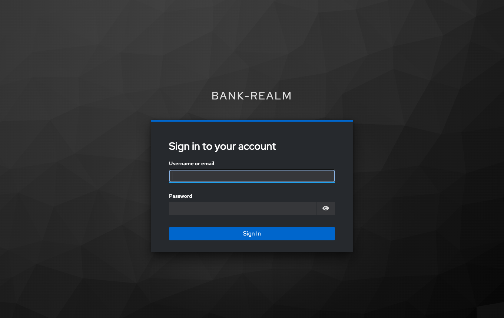

---

## 7. Chatbot agentique (partie E)

`chat-bot-service` combine trois éléments :

- un **LLM distant** (Groq, API compatible OpenAI) appelé par Spring AI 2.0. La clé est lue depuis `.env`, qui
  n'est pas versionné ; `.env.example` sert de modèle ;
- un **client MCP** (SSE) connecté au serveur MCP d'account-service et à celui de transaction-service ;
- **`BankAgent`** : un `ChatClient` qui reçoit les 12 tools MCP comme `defaultToolCallbacks`, avec un prompt
  système en français. L'agent n'invente jamais de solde, rappelle les montants avant une écriture et explique les
  erreurs métier.

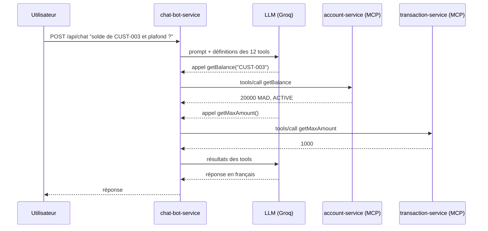

Deux clients ont été testés : un client **REST** (`POST /api/chat`) et l'onglet *Assistant* du front.

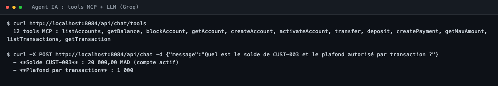

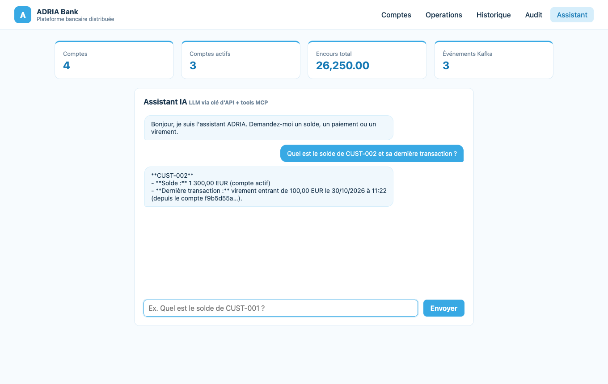

---

## 8. Communication asynchrone avec Kafka (partie F)

| Exigence | Implémentation |
|---|---|
| Publier après la persistance réussie | `TransactionEventPublisher` est un `@TransactionalEventListener(phase = AFTER_COMMIT)`. En cas de rollback, rien n'est publié. |
| Topic `bank.transactions.created` | créé par `KafkaTopicConfig` : 3 partitions, réplication 1 |
| Clé = `accountId` | `kafkaTemplate.send(topic, accountId, json)` : tous les événements d'un compte arrivent sur la même partition, dans l'ordre |
| Format de l'événement | `TransactionCreatedEvent` : `eventId`, `eventType="TransactionCreated"`, `transactionId`, `accountId`, `amount`, `currency`, `occurredAt` |
| Consumer | `audit-service`, `@KafkaListener(groupId = "audit-service")` |
| Journaliser sans modifier les données bancaires | log `[AUDIT]` + table `audit_entries` (clé, partition, offset, payload). Aucun appel vers account ou transaction. |

Si Kafka est indisponible, l'échec de publication est journalisé, et la transaction bancaire déjà validée n'est pas
annulée (`max.block.ms=3000`).

Dans la capture ci-dessous, les événements de CUST-002 (clé `bec7808d…`) tombent tous sur la partition 2.

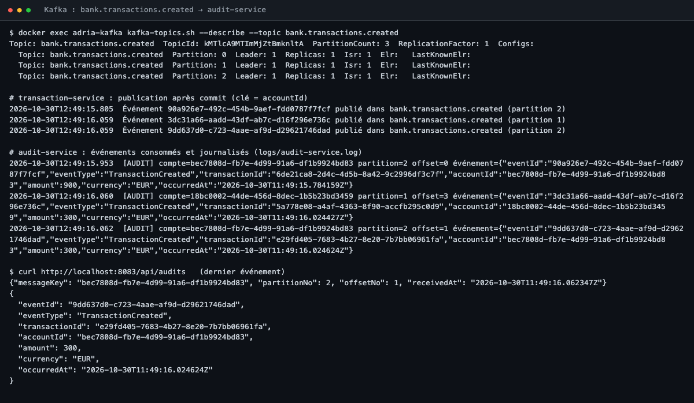

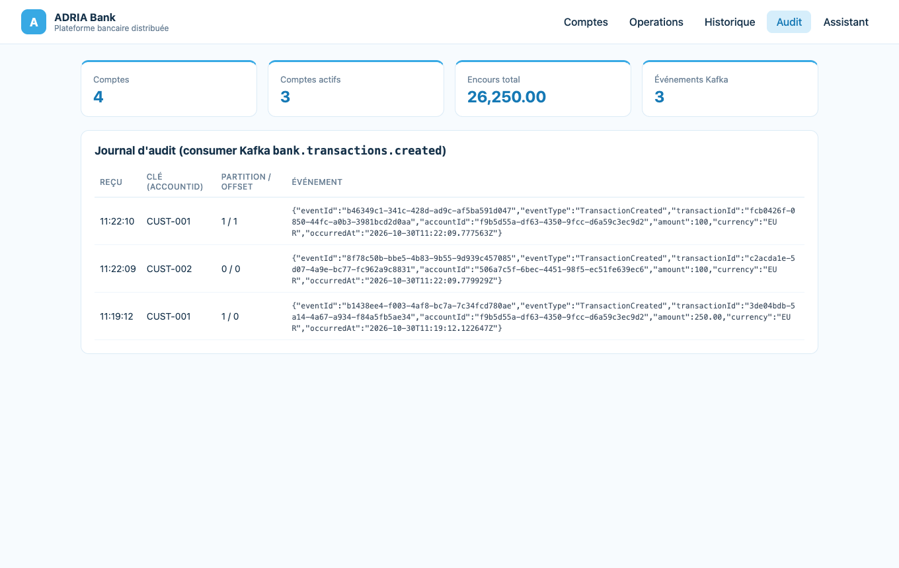

---

## 9. Front Angular (partie G)

Le front est en Angular 22 : composants *standalone* et *signals*. Le serveur de développement utilise
`proxy.conf.json` :

- `/api/accounts` et `/api/transactions` vont vers la gateway (9090) ;
- `/api/audits` va vers audit-service (8083) ;
- `/api/chat` va vers chat-bot-service (8084).

- **Authentification** : keycloak-js en `login-required`, avec PKCE S256. Un intercepteur HTTP ajoute le Bearer
  token, et le token est rafraîchi toutes les 30 s. La sécurité se désactive dans `public/config.json`
  (`securityEnabled`).
- **Onglets** :
  - *Comptes* : liste, création, blocage et activation ;
  - *Opérations* : paiement, dépôt, virement ;
  - *Historique* : transactions, filtrables par compte ;
  - *Audit* : événements Kafka reçus ;
  - *Assistant* : chat avec l'agent IA.
- **Indicateurs** en haut de page : nombre de comptes, comptes actifs, encours total, nombre d'événements Kafka.

| | |
|---|---|
| 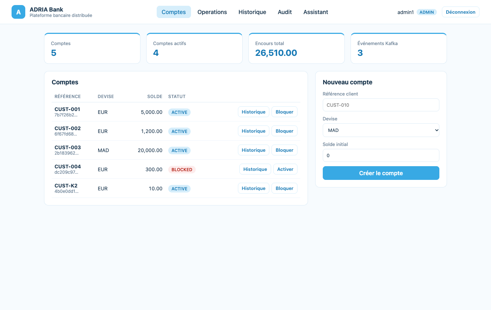 | 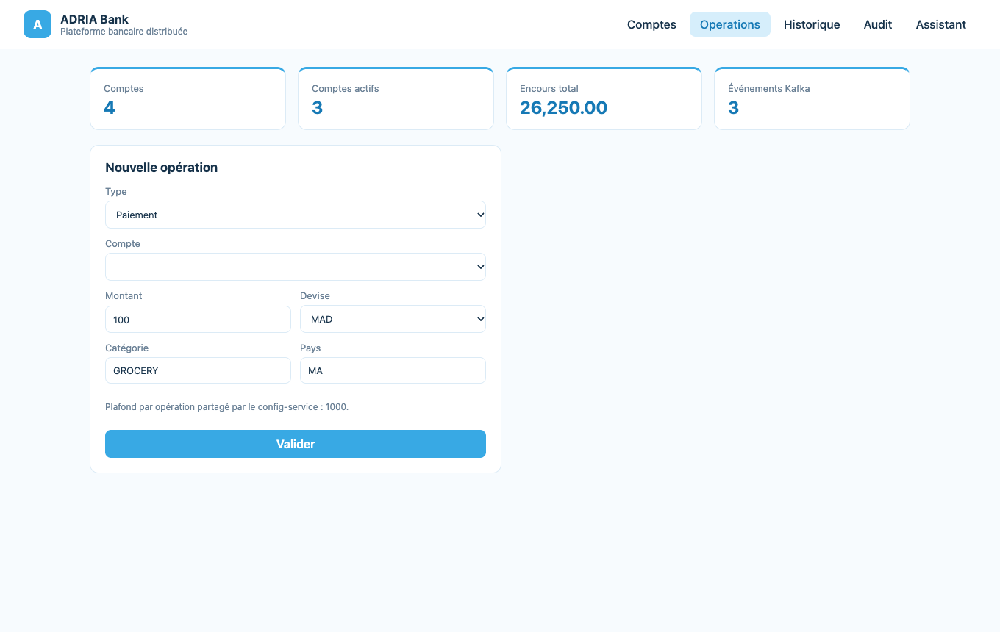 |
| 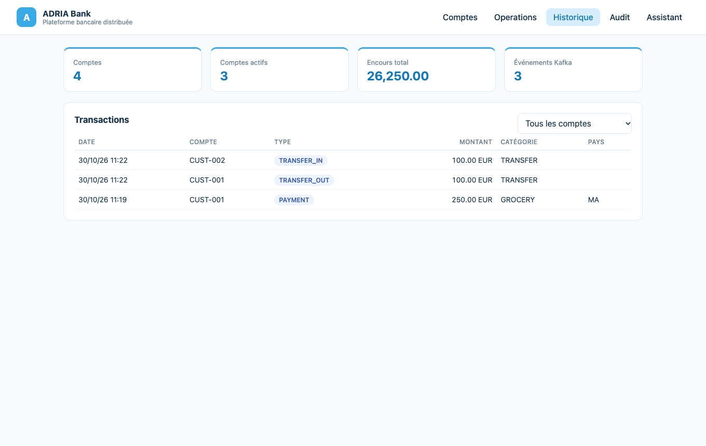 | 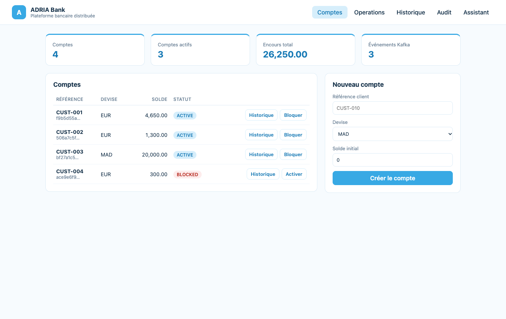 |

---

## 10. Détection de fraude (partie H)

### Jeu de données

`bank_transactions.csv` contient 5000 transactions, dont 257 fraudes (**5,14 %**) : les classes sont fortement
déséquilibrées. Trois colonnes ont des valeurs manquantes : `country` (66), `merchant_category` (84) et
`average_amount_last_7d` (75).

Les fraudes ont en moyenne :

- un montant deux fois plus élevé (252 contre 121) ;
- plus de transactions sur 24 h (5,9 contre 3,7) ;
- une part nocturne plus forte (41 % contre 25 %).

### Ce qui a été livré

1. **`ml/fraud_model.py`** est un pipeline scikit-learn. Il **n'a pas été exécuté** : aucun résultat n'est
   présenté. Il couvre :
   - un split train/test stratifié (75/25) ;
   - l'exclusion des identifiants (`transaction_id`, `account_id`) ;
   - un `ColumnTransformer` : `StandardScaler` sur les variables numériques, `OneHotEncoder(handle_unknown="ignore")`
     sur les catégorielles ;
   - deux variables dérivées : `amount_ratio_7d` et `is_night` ;
   - un `HistGradientBoostingClassifier(class_weight="balanced")` ;
   - un seuil choisi sur les données d'entraînement uniquement ;
   - des métriques : rapport précision / rappel / F1, matrice de confusion, average precision.
2. **`chat-bot-service` `/api/fraud`** fait une détection par LLM, sans entraînement. Le prompt contient des
   exemples étiquetés tirés du CSV (*few-shot*, 8 fraudes et 12 non-fraudes) et les statistiques du jeu.
   `/api/fraud/evaluate?n=` calcule la précision, le rappel et le F1 sur un échantillon hors exemples.

Exemple réel ci-dessous : la transaction TX000396 est étiquetée fraude dans le CSV, mais le LLM la classe non
frauduleuse (probabilité 0,15). C'est un **faux négatif**, qui illustre la question 2.

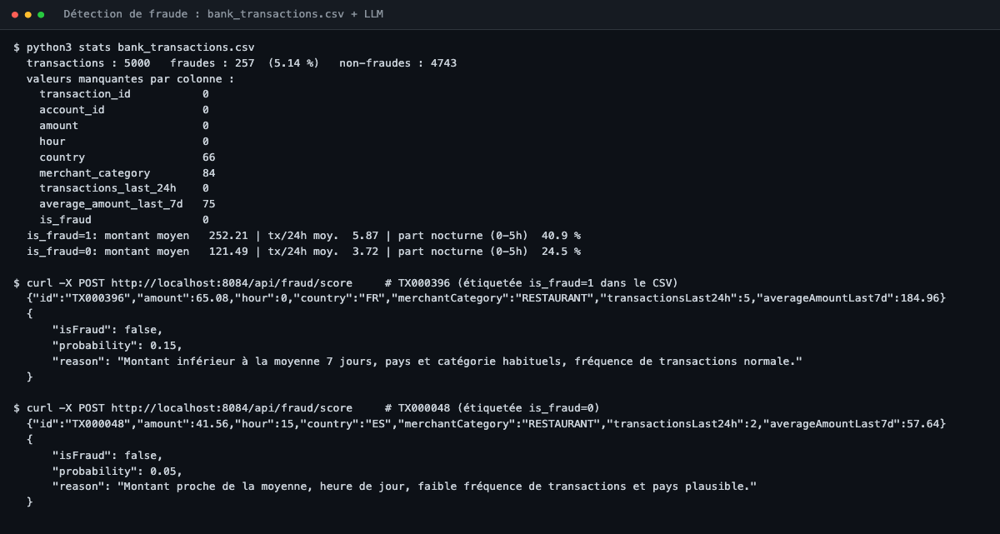

### Réponses aux questions d'analyse

1. **Pourquoi l'accuracy seule est-elle insuffisante ?** Avec 5,14 % de fraudes, un modèle qui répond toujours
   « non-fraude » obtient 94,86 % d'accuracy et ne détecte **aucune** fraude. Il faut regarder la précision et le
   rappel de la classe fraude, le F1 et l'average precision (aire sous la courbe précision-rappel), qui ne sont
   pas dominés par la classe majoritaire.
2. **Compromis entre faux positifs et fraudes non détectées.** Un faux positif bloque ou contrôle un client
   honnête : coût opérationnel, frustration, risque de départ. Un faux négatif laisse passer une fraude : perte
   financière directe et risque réglementaire. On ne peut pas minimiser les deux à la fois. Le point de
   fonctionnement se choisit selon le coût relatif des deux erreurs et la capacité de l'équipe à traiter les
   alertes.
3. **Effet d'une diminution du seuil de décision.** Plus de transactions sont déclarées frauduleuses : le
   **rappel augmente** (moins de fraudes manquées), la **précision baisse** (plus de fausses alertes) et le volume
   d'alertes à traiter grandit. Le faux négatif ci-dessus (probabilité 0,15) serait rattrapé avec un seuil plus
   bas.
4. **Pourquoi une validation temporelle sur des données réelles ?** Les fraudeurs adaptent leurs méthodes : la
   distribution change dans le temps (*concept drift*). Un split aléatoire mélange passé et futur : le modèle
   apprend sur des transactions postérieures à celles qu'il évalue, ce qui surestime ses performances. Entraîner
   sur le passé et tester sur une période ultérieure reproduit l'usage réel et respecte la contrainte que les
   variables historiques ne voient que le passé.

---

## 11. DevOps (partie I)

### Livré

`docker-compose.yml` lance l'**infrastructure** :

- Kafka en mode KRaft, sans Zookeeper ;
- Keycloak 26.2, avec import automatique du realm.

Les micro-services se lancent avec `scripts/start-all.sh` (voir §13).

### Non livré

Les questions I.1 à I.3 n'ont pas été réalisées : il n'y a ni Dockerfile pour les micro-services, ni services
applicatifs dans le Compose, ni pipeline GitHub Actions.

### Réponses courtes (I.4)

- **Secrets et configuration.** La configuration (plafond, URLs, ports) n'est pas sensible : elle est versionnée et
  servie par le config-service. Les secrets (clé du LLM, secret du client `bank-agent`, mots de passe) ne doivent
  jamais être versionnés. Ici, la clé Groq est dans `.env`, ignoré par git. En production, ils viendraient d'un
  coffre (Vault, Kubernetes Secrets, secrets GitHub Actions) injecté en variables d'environnement.
- **Contrôles de démarrage, de disponibilité et de vitalité.** Spring Boot Actuator expose `/actuator/health`, avec
  des groupes `liveness` et `readiness` qui alimentent les probes Kubernetes :
  - la *startup probe* laisse le temps du démarrage (ici, environ 30 s pour récupérer le registre Eureka) ;
  - la *readiness* retire l'instance du trafic si ses dépendances (base, account-service) ne répondent pas ;
  - la *liveness* redémarre un processus bloqué.
- **Logs, métriques et traces distribuées.** Il faut :
  - des logs structurés en JSON, centralisés (ELK ou Loki) ;
  - des métriques Micrometer exposées à Prometheus et affichées dans Grafana (latences, taux d'erreur, état du
    circuit breaker Resilience4J, *lag* Kafka) ;
  - des traces OpenTelemetry propagées par la gateway, Feign et Kafka, pour suivre une transaction de bout en
    bout avec un identifiant de corrélation.
- **Stratégie de rollback.**
  - images immuables, taguées par SHA de commit ;
  - déploiement progressif (rolling, blue/green ou canary), avec retour à l'image précédente
    (`kubectl rollout undo`) si les probes ou les métriques se dégradent ;
  - migrations de base rétrocompatibles (*expand / contract*), pour que l'ancienne version fonctionne encore
    avec le nouveau schéma.

---

## 12. Tests

`mvn test` depuis le pom agrégateur exécute **35 tests** sur 7 modules, sans échec.

| Module | Tests | Contenu |
|---|---|---|
| account-service | 19 | règles du service (8), REST MockMvc (5 : 201, 400, 404, 409), GraphQL `HttpGraphQlTester` (3), publication des tools MCP (2), contexte (1) |
| transaction-service | 12 | chaque règle métier avec Mockito sur `AccountClient`, virement nominal, virement vers le même compte, compensation, contexte |
| audit-service | 1 | le consumer enregistre clé, partition, offset et payload |
| config, discovery, gateway | 3 | chargement du contexte |

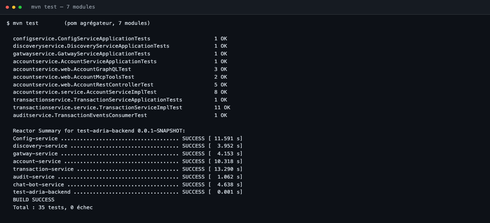

---

## 13. Lancer le projet

Prérequis :

- JDK 21 ;
- Maven, ou le wrapper `./mvnw` ;
- Docker ;
- Node 22 ou plus, pour le front ;
- une clé Groq dans `.env`, pour l'agent IA (voir `.env.example`).

```bash
# 1. Infrastructure : Kafka + Keycloak (realm importé automatiquement)
docker compose up -d

# 2. Build de tous les modules
./mvnw -DskipTests package

# 3. Services, dans l'ordre : config, discovery, account, transaction, audit, gateway, chat-bot
./scripts/start-all.sh        # logs dans logs/, arrêt : ./scripts/stop-all.sh

# 4. Front
cd front-end && npm install && npm start      # http://localhost:4200  (admin1 / 1234)
```

Comptez environ **30 secondes** après le démarrage avant que la gateway et Feign trouvent les autres services
dans Eureka. Avant ce délai, ils répondent 503.

Pour appeler les API sans le front, obtenez un token technique (rôle AGENT) :

```bash
TOKEN=$(curl -s -X POST localhost:8080/realms/bank-realm/protocol/openid-connect/token \
  -d grant_type=client_credentials -d client_id=bank-agent -d client_secret=bank-agent-secret | jq -r .access_token)
curl -H "Authorization: Bearer $TOKEN" localhost:9090/api/accounts
```

Pour développer sans Keycloak, lancez les services avec `SECURITY_ENABLED=false` et mettez
`securityEnabled: false` dans `front-end/public/config.json`.

---

## 14. Limites connues et améliorations

Constats faits en analysant le code et en exécutant la stack :

| # | Constat | Impact | Correction proposée |
|---|---|---|---|
| 1 | Les endpoints MCP (`/sse`, `/mcp/**`) sont publics, même avec la sécurité activée, et le chat-bot n'envoie pas de token (le client `bank-agent` existe mais n'est pas utilisé). | N'importe qui sur le réseau peut appeler les tools d'écriture (`createPayment`, `transfer`, `blockAccount`). | Exiger le rôle `AGENT` sur `/sse` et `/mcp/**`, et faire obtenir un token `client_credentials` au chat-bot, injecté dans le transport MCP. |
| 2 | audit-service et chat-bot-service ne sont ni derrière la gateway ni sécurisés (`GET :8083/api/audits` répond 200 sans token). | Le journal et l'agent sont accessibles sans authentification. | Ajouter leurs routes à la gateway et le resource server JWT. |
| 3 | Les tests `@SpringBootTest` de transaction-service et de la gateway démarrent un vrai client Eureka. Lancés pendant que la stack tourne, ils s'enregistrent puis se désinscrivent sous le même identifiant que les vraies instances. | Pendant quelques secondes, la gateway renvoie « Unable to find instance » (constaté pendant la rédaction de ce rapport, avec retour à la normale au battement de cœur suivant). | `eureka.client.enabled=false` dans les propriétés de test. |
| 4 | Partie H : le pipeline n'a pas d'étape d'**imputation**, alors que l'énoncé la demande et que 225 lignes ont des valeurs manquantes. Le seuil est choisi sur les prédictions du jeu d'entraînement, qui sont optimistes. Le script n'a pas été exécuté. | Pas de métriques réelles à présenter. | `SimpleImputer` (médiane, ou valeur la plus fréquente) dans chaque branche du `ColumnTransformer` ; seuil choisi par validation croisée (`cross_val_predict`) sur le train ; exécution et résultats dans un notebook. |
| 5 | La détection de fraude par LLM est non déterministe et coûteuse (un appel par transaction). Elle a manqué une fraude dans l'exemple de la capture. | Inadaptée au scoring en volume. | La garder comme explication et utiliser le modèle scikit-learn pour le score. |
| 6 | Pas de Dockerfiles ni de CI (partie I). | Déploiement manuel. | Dockerfile multi-étapes par service, services dans le Compose, workflow GitHub Actions (build, test, image, push GHCR, déploiement). |
| 7 | Le virement est une compensation simple, pas une saga persistée. Si le service tombe entre le débit et le crédit, la compensation n'est pas rejouée. | Incohérence possible en cas de panne à ce moment précis. | Transactions en statut `PENDING`, avec reprise, ou pattern *outbox*. |
| 8 | Les bases H2 sont en mémoire. | Données perdues à chaque redémarrage. | PostgreSQL par service (profil Docker). |
| 9 | Le plafond est lu une seule fois, au démarrage. | Le modifier impose de redémarrer transaction-service. | `@RefreshScope` et `/actuator/refresh`, ou Spring Cloud Bus. |
| 10 | La Javadoc de `SecurityConfig` dit la sécurité « désactivée par défaut », alors que le yaml l'active par défaut. Les versions de Spring Boot diffèrent entre modules (4.0.9 / 4.1.2). Le module s'appelle `gatway-service` (sans « e »). | Lisibilité. | Harmoniser. |
